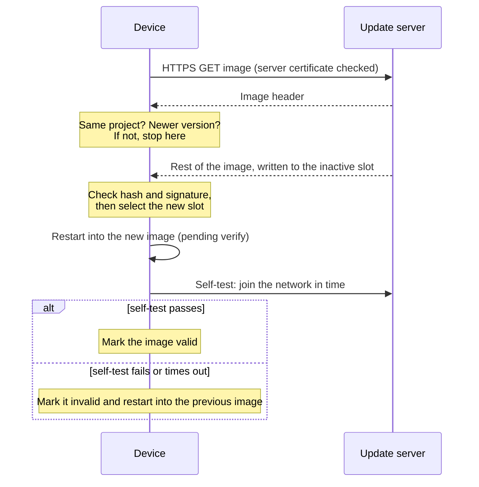

# esp32-secure-ota

[](https://github.com/PATEmbedded/esp32-secure-ota/actions/workflows/ci.yml)
[](LICENSE)

Firmware updates over HTTPS for ESP32 and ESP32-S3 with ESP-IDF. Images are signed, the server is authenticated, older versions are refused, and a new image that fails its self-test is rolled back automatically.

## Update flow



## What is checked

- **Server identity.** TLS against the public CAs of the ESP-IDF certificate bundle, or against one pinned CA. Plain HTTP is refused.
- **Image origin.** Only images signed with the release key are installed (`CONFIG_SECURE_SIGNED_APPS_NO_SECURE_BOOT`): ECDSA P-256 on ESP32, RSA-3072 on ESP32-S3.
- **Image integrity.** The SHA-256 in the image is checked before the new slot is selected, so an interrupted download never boots.
- **Project and version.** The image header is read before the download continues. Images for another project, or not newer than the running app by semantic-version rules, are rejected. eFuse anti-rollback can be added on top.
- **Health after the update.** A new image must join the network within `CONFIG_SOTA_WIFI_TIMEOUT_MS`, or the bootloader returns to the previous image.

The [threat model](docs/threat-model.md) lists what each check protects against and what needs Secure Boot V2 and flash encryption.

## Layout

```
components/secure_ota/    update logic, reusable in other projects
  secure_ota.c            download, checks, install, boot confirmation
  secure_ota_version.c    semantic versions and the install decision (plain C)
main/                     demo app: Wi-Fi, self-test, periodic update checks
test/host/                unit tests for the version logic, run on a PC
tools/                    test certificates and a local HTTPS server
partitions.csv            two OTA slots, no factory app (4 MB flash)
```

## Build

Requires ESP-IDF 5.x or 6.x.

1. Create a signing key in the project folder. Keep it secret; git ignores it.

   ```sh
   # ESP32: ECDSA P-256
   openssl ecparam -name prime256v1 -genkey -noout -out secure_boot_signing_key.pem
   # ESP32-S3: RSA-3072
   openssl genrsa -out secure_boot_signing_key.pem 3072
   ```

2. Select the chip and set Wi-Fi and the firmware URL under *Secure OTA* in menuconfig:

   ```sh
   idf.py set-target esp32s3
   idf.py menuconfig
   ```

3. Build, flash and watch the log:

   ```sh
   idf.py build flash monitor
   ```

The build signs `build/secure_ota_demo.bin`; that file is what you publish.

## Publishing an update

1. Raise the version in `version.txt`, for example to `1.1.0`.
2. Build. The image is signed with the release key.
3. Upload `build/secure_ota_demo.bin` to the firmware URL. Devices install it at their next check (`CONFIG_SOTA_CHECK_INTERVAL_S`).

### Testing on a local network

```sh
tools/make_test_certs.sh 192.168.1.20               # address of the PC that serves the image
cp test-certs/ca.pem main/certs/server_ca.pem       # then select "Only the CA in main/certs/server_ca.pem"
python tools/serve_https.py build --cert test-certs/server.pem --key test-certs/server.key
```

Set the firmware URL to `https://192.168.1.20:8443/secure_ota_demo.bin`. Restore `main/certs/server_ca.pem` before committing.

## Using the component in another project

Copy `components/secure_ota` into your project and call it from your app:

```c
#include "secure_ota.h"

secure_ota_confirm_boot(self_test_passed());  // once at start-up

const secure_ota_config_t config = {
    .firmware_url = "https://updates.example.com/app.bin",
    .server_ca_pem = NULL,  // public CAs from the certificate bundle
    .timeout_ms = 10000,
};
if (secure_ota_update(&config) == SECURE_OTA_INSTALLED) {
    esp_restart();
}
```

Copy the rollback, signing and partition settings from `sdkconfig.defaults` as well.

## Production devices

The default configuration burns no eFuses, so a development board stays reusable. Devices in the field should also enable:

- **Secure Boot V2**, so only signed bootloaders and apps run, even after flashing over the serial port
- **Flash encryption**, so the image and the Wi-Fi credentials in NVS cannot be read out of the flash chip
- **Anti-rollback** (`CONFIG_BOOTLOADER_APP_ANTI_ROLLBACK`), with a security version that rises with each security fix

These are one-way changes. Follow the ESP-IDF security guides and try them on spare boards first.

## Tests

Unit tests for version parsing, semantic-version precedence and the install decision run on a PC, with AddressSanitizer and UBSan in CI:

```sh
cmake -S test/host -B build-host -DSECURE_OTA_SANITIZE=ON
cmake --build build-host
ctest --test-dir build-host --output-on-failure
```

CI also builds and signs the firmware with ESP-IDF 5.5 and 6.0 for ESP32 and ESP32-S3, using a throwaway key.

## License

MIT. See [LICENSE](LICENSE).
